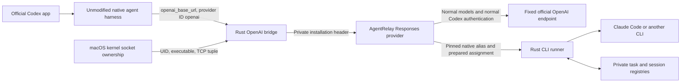

# Built-in OpenAI bridge

## Outcome and status

The macOS Rust bridge in version 0.4.1 lets the unmodified official Codex executable retain `model_provider = "openai"` while AgentRelay still runs genuine native CLI agents. The installed desktop account-menu code suppresses the provider row for that ID. No model name, account name, app bundle or native chat database is patched.

Activate the bridge explicitly with `agentrelay codex migrate` after installing/upgrading the companion. Installation retains the legacy mode until migration; later upgrades preserve the selected mode. `codex rollback` restores prior routing. Both changes require idle external workers. Migration preserves the legacy provider definition, native histories and external session bindings.

## Architecture



The supported attachment point is `openai_base_url`, not an override of `[model_providers.openai]`, which the tested binary rejects. The endpoint is a credential-free IPv4 loopback URL. The temporary Codex configuration uses:

```toml
model_provider = "openai"
openai_base_url = "http://127.0.0.1:39092"
# Keep the generated catalog and native agent roles configured as usual.
```

`serve` reads private `transport.json` and owns both listeners in one process after migration. A failure of either server ends the shared process so launchd can recover it. `serve-openai` remains a standalone diagnostic command, rather than a second service to install. The bridge forwards to the existing provider protocol on a different loopback port. The underlying runtime adapters, native identities, prepared-task bindings and immutable model profiles remain the same. There is no extra model interpreting the CLI result.

## Admission and transport

The built-in provider cannot attach AgentRelay's custom local header. Instead, the bridge checks the actual connecting process through macOS `libproc`:

1. Restrict both listeners to IPv4 loopback.
2. Find a process with the same effective and real user ID and the configured executable path.
3. Match its established TCP socket to the exact reverse client/server address-and-port tuple.
4. Recheck executable path and process start time after descriptor inspection.
5. Reject browser `Origin` requests. HTTP process-name/PID headers never authorize a request.
6. Replace any incoming local-key header with the key read from private AgentRelay state before contacting the backend.

The private transport manifest stores the primary desktop executable and an optional list of additional native Codex executables. Migration discovers the native `codex` on PATH and preserves explicitly registered entries. Each request must match one of their canonical executable paths and the exact socket tuple; knowing a PID, filename or HTTP header is insufficient. A removed or invalid optional executable is skipped without stopping the primary desktop transport. Rerun migration after upgrading an additional CLI. This prevents a Homebrew CLI or the AgentRelay `codex` runtime from being rejected merely because it differs from the desktop bundle.

The desktop's `bin/codex` can be a shell launcher. The bridge resolves the known `CodexCLI.app/Contents/MacOS/codex` bundle layout; it does not execute or parse arbitrary shell scripts. Native targets must have Mach-O magic and executable permissions. For npm or another script launcher, supply its real native Codex target using repeatable `--also-codex-bin /absolute/native/codex`; unresolved PATH scripts stop migration before changing service/configuration unless an explicit target was provided. Never register the generic Node or shell interpreter. Executable-path checks are not code-signature verification or an OS sandbox. As with the existing integration, processes controlling the user's private files are inside the trust boundary.

The bridge preserves streaming response status/headers and propagates downstream cancellation. It decodes built-in-provider Zstandard requests with a bounded decoded size. The backend still strips the private local header before forwarding normal requests to the fixed official HTTPS endpoint. The bridge refuses a backend whose `/version` does not advertise `native_checkpoints_v1`, including the previously released 0.3.4 provider. The guardian and installer require both version endpoints to respond and report the same PID.

Built-in OpenAI transport tries WebSockets. An admitted handshake receives HTTP 426, which the official client explicitly handles by falling back to HTTP/SSE for that session. Native tests verify execution after this negotiation. WebSocket framing and incremental request reconstruction are not reimplemented.

## Automatic compaction

Keeping provider ID `openai` also enables native remote-compaction behavior. A forced automatic-compaction test initially failed: the old provider consumed the prepared task as if compaction were normal inference. The external task ran, but the native turn failed because the response contained no compaction item.

The provider now dispatches compaction separately and rejects non-task operations at the external execution claim boundary. A native wrapper checkpoint pins the prepared root/path/model to the actual child and stores a durable, idempotent random reference. It does not consume the pending assignment, advance a CLI generation or launch a model. The Responses protocol's opaque `encrypted_content` field carries that local reference; it is not OpenAI ciphertext and no native encrypted prompt is decoded. The external CLI retains its own complete session/context. Later local checkpoint references are checked against the bound root, path, child and model before a new task is claimed.

The acceptance test sets the worker catalog's automatic-compaction threshold to zero in a temporary Codex home. The official harness performs compaction before both task turns. Both complete, and Claude recalls the previous result in the same external session. Exactly two external turns run for two prepared tasks; compaction creates no additional model inference.

## Verification

Tests use the unmodified desktop-bundled `codex-cli 0.163.0-alpha.10.2`, temporary workspaces/state/configuration and ephemeral ports. Existing authentication is linked privately for live OpenAI probes; account tokens and full transcripts remain excluded from version control.

The sanitized report records the ordinary checks, explicit native acceptance, installed-service checks, formatting and clippy with warnings denied for this release. See [sanitized results](../evidence/openai-bridge-results.json). Raw prompts, tokens, local identifiers and process diagnostics stay private.

| Check | Result |
| --- | --- |
| Kernel ownership, exact executable and TCP tuple | Accepted matching socket; rejected mismatched executable/tuple |
| Actual different executable with forged identity headers and known local key | HTTP 403; backend not called |
| Browser Origin | HTTP 403 |
| Multiple native executables | Primary and explicit secondary admitted; byte-identical unlisted copy denied |
| Optional executable removed | Desktop listener stays healthy; missing entry cannot authorize requests |
| Legacy transport manifest | Deserializes with an empty additional-executable list |
| Zstandard, decoded size limit, headers and streaming | Passed |
| Downstream cancellation | Backend response stream closed |
| Haiku 5.5 high | Native execution and same-session follow-up passed |
| Opus 5.5 high | Native execution and same-session follow-up passed |
| Real OpenAI parent through an observing fixture | Authenticated delegation and native completion passed; no child OpenAI inference |
| Real OpenAI parent and Claude child directly through production provider | Passed without the scripted routing fixture |
| Forced automatic native compaction | Two completed compactions, two task executions, same external session |
| Bridge killed/restarted between parent turns | Existing native agent resumed; same external task/session and high-effort model |
| UI identity | Parent and child report `modelProvider: openai`; installed account-menu helper suppresses its row |

The service integration additionally verifies real launchd recovery after freezing the shared process and after unloading its registration, persisted legacy-chat/child resume after an app-server restart and provider migration, normal parent compaction and account/rate-limit APIs. Rendered desktop screenshots remain unverified: Computer Use denies the Codex application for safety reasons. No alternative capture path is used to bypass that denial. Cancellation propagates to the owned runner; a crash may interrupt an in-flight turn, and recovery preserves external session IDs for explicit follow-up rather than automatically repeating work.

Reproduce the ordinary and explicit live checks:

```bash
cargo test --all-targets --locked
cargo clippy --all-targets --locked -- -D warnings
cargo fmt --check
AGENTRELAY_CODEX_TEST_BIN=/absolute/path/to/official/codex \
  AGENTRELAY_TEST_EVIDENCE=evidence/private/openai-bridge \
  cargo test --test native_provider --locked builtin_openai_bridge \
    -- --ignored --test-threads=1 --nocapture --skip installed_openai_service_native_chat_and_followup
```

The live suite consumes OpenAI and Claude usage. Standalone foreground bridge command, after starting a checkpoint-capable backend built from the same source and using the same private state:

```bash
agentrelay --home /private/relay-state serve-openai \
  --listen 127.0.0.1:39092 --backend 127.0.0.1:39091 \
  --codex-bin /Applications/ChatGPT.app/Contents/Resources/codex-cli/bin/codex
```

Ordinary native acceptance uses isolated configurations. The separately ignored installed-service test explicitly creates one test chat/child in the normal user state after local activation. `codex configure` and future upgrades preserve a saved bridge configuration. They do not rewrite existing chats.

## Activation and rollback

```bash
./agentrelay codex upgrade --wait-idle
relay_command="$HOME/.agents/skills/agentrelay/scripts/agentrelay"
"$relay_command" codex migrate
# To restore pre-bridge routing later:
"$relay_command" codex rollback
```

Migration uses an exclusive lock. It validates local endpoints and the executable, preserves a private `config.before-openai-bridge.toml`, stages transport settings, restarts the owned service and waits for both listeners before atomically switching the user configuration. Activation failure restores exact previous configuration/transport bytes and restarts the previous service. A pre-existing unrelated OpenAI endpoint is refused. Rollback restores routing fields only, retaining later unrelated preferences.

Historical chats keep the `agentrelay` provider definition and legacy private-header listener. The official app-server acceptance test persists a native Haiku chat, restarts the server after switching the global default to OpenAI, resumes the original root and follows up the original child in the same external session. A newly created thread uses `openai`. No Codex SQLite database or rollout is rewritten to change provider metadata.

The guardian probes both listeners and their PID agreement. It restores an unloaded service and restarts a verified hung process only after three spaced failures. The isolated launchd fault test freezes only its fixture PID and verifies that both listeners recover, then unloads/re-registers that fixture. Healthy services remain running.

Reload the app configuration after activation. Visual verification of the account menu remains a manual acceptance step while the host denies Computer Use; the release does not claim a screenshot that was not captured.
