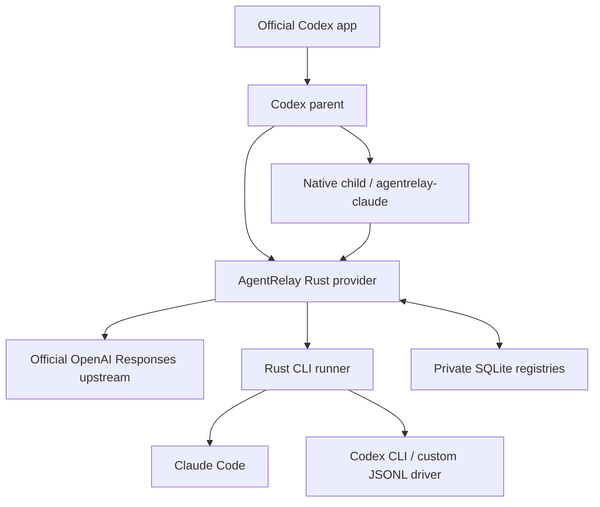
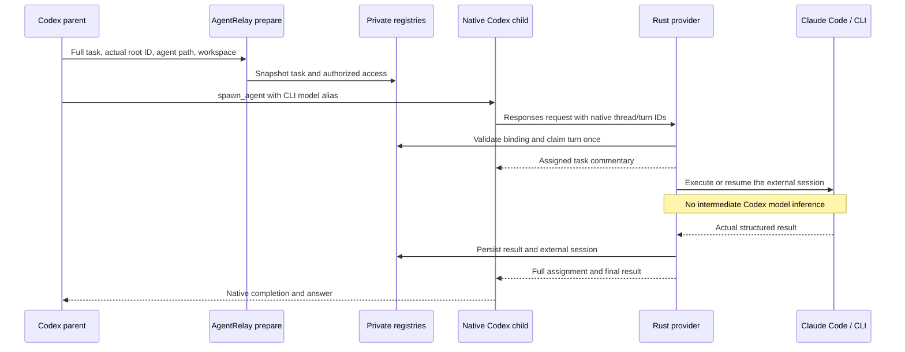
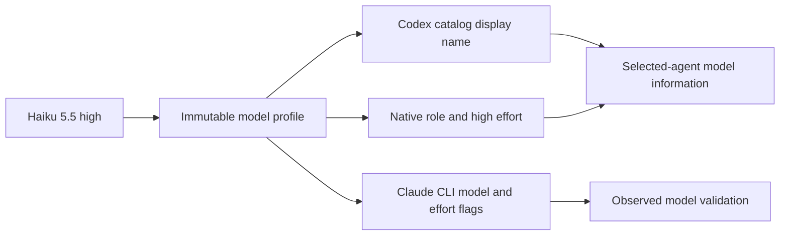
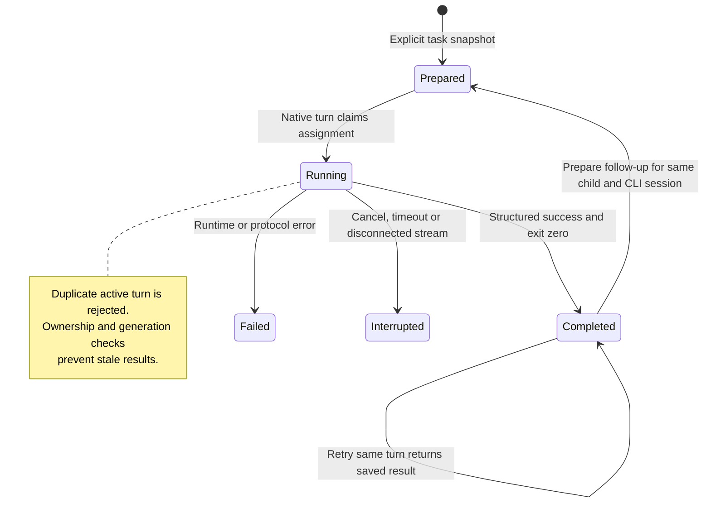

# AgentRelay

Run Claude Code and other agent CLIs as **native agents in the official Codex app**, with no MCP, no Codex rebuild, and no intermediate Codex model executing the delegated task.

AgentRelay is a Rust companion with a local Responses provider, CLI adapters, a durable task registry, a user skill and native agent roles. Codex owns the parent/child threads, activity and messaging. The companion fulfills a child's model request using an actual CLI session.

## See it in action: Codex Loves Claude Code ❤️

Keep your conversation in Codex, delegate to Claude Code, and inspect its work in the native agent panel. With AgentRelay installed and configured, paste this into a Codex conversation:

```text
Use $agentrelay to create a native agent named claude_greeting,
running Claude Code with Haiku 5.5 and high effort, in read-only mode.

Ask the agent to reply with exactly these two lines:
Codex Loves Claude Code ❤️
AgentRelay is fantastic!

Do not modify any files. Wait for the agent to finish.
```

Open `claude_greeting` in the agent panel to see Claude Code's response:

```text
Codex Loves Claude Code ❤️
AgentRelay is fantastic!
```

This demonstration ran in the official Codex desktop app. The child detail shows the assigned task, the Claude runtime, requested and observed model `claude-haiku-5-5`, requested effort and actual result. Codex can then report that result in the main conversation. Replace the greeting with a code review, architecture analysis or implementation task to use the same delegation flow for real work.

## How it works



Normal model requests pass through to the fixed official OpenAI HTTPS endpoint. Requests for `agentrelay-RUNTIME` execute an explicitly prepared CLI task bound to the actual native root, canonical agent path, child thread and turn. The child uses the same provider as its parent. A role selects the CLI model alias; a skill alone cannot replace a native agent backend.

There is **no extra Codex model inside the child**. The parent still consumes its normal Codex usage for planning, delegation, waiting and reporting. Claude Code consumes its own usage through its own login. AgentRelay itself performs no model inference. External usage events stay in the local registry; they are not fabricated as OpenAI token usage.

### One delegation, end to end

The parent prepares the full task before spawning the child. Codex manages the native thread; AgentRelay executes the external turn and records both the assignment and its answer.



## Download and run on macOS

Download a prebuilt companion from [GitHub Releases](https://github.com/mapo80/agnet-relay/releases/latest). Rust is not required to run it. Choose `macos-arm64` for Apple Silicon or `macos-x86_64` for Intel. The companion is a terminal executable and optional background service; the interface remains the official Codex app.

For version 0.3.1, download and verify the archive in Terminal:

```bash
relay_version=0.3.1
relay_arch=$(uname -m)
relay_archive="agentrelay-v${relay_version}-macos-${relay_arch}.tar.gz"
relay_url="https://github.com/mapo80/agnet-relay/releases/download/v${relay_version}"
curl --fail --location --remote-name "$relay_url/$relay_archive"
curl --fail --location --remote-name "$relay_url/$relay_archive.sha256"
shasum -a 256 -c "$relay_archive.sha256"
tar -xzf "$relay_archive"
cd "${relay_archive%.tar.gz}"
./agentrelay --version
```

The release also provides combined `SHA256SUMS`. These hashes verify download integrity; the binaries are not Developer ID signed or notarized. If macOS blocks execution, review the download and use the normal macOS approval controls. No Gatekeeper bypass is installed.

Install/authenticate Claude Code separately, and open/login to Codex once so it has a current model cache. Then install the companion for all local projects of your user:

```bash
./agentrelay codex install --user
relay_command="$HOME/.agents/skills/agentrelay/scripts/agentrelay"
"$relay_command" profile add haiku55_high --runtime claude \
  --model "Haiku 5.5" --effort high --display-name "Claude Haiku 5.5"
"$relay_command" codex configure
"$relay_command" codex service-install
```

Start a new Codex conversation using the `agentrelay` provider; restart Codex if it retains the previous catalog. Ask to use `$agentrelay` with Haiku 5.5 high. The native profile exposes the corresponding model name and effort through Codex's catalog/thread settings.

To run in the foreground instead of installing the background service, use `"$relay_command" serve`. Use one service instance on the configured port. To stop the macOS service, first finish or interrupt active tasks, then run `launchctl bootout gui/$(id -u)/com.agentrelay.provider`. Provider routing depends on the running service; restore the original provider settings when disabling it permanently.

The installed executable stays at `~/.agents/skills/agentrelay/scripts/agentrelay`. Commands below use the short name `agentrelay`; either use that full path or add its directory to your PATH. See [release automation](docs/releases.md) for build, packaging and update details.

## Build from source

Requirements: Rust/Cargo 1.95+, macOS or Linux, a recent Codex version supporting multi-agent v2/custom providers, and independently installed/authenticated external CLIs. Windows is not supported. Automatic background service installation currently targets macOS.

```bash
cargo build --release --locked
target/release/agentrelay doctor --runtime claude
target/release/agentrelay codex install --user
target/release/agentrelay codex configure
target/release/agentrelay codex service-install
```

Start a **new conversation in the official Codex app** after configuration. Existing conversations can retain their original provider. Confirm that the conversation uses `agentrelay`; do not select a CLI alias for the main conversation. Keep the ordinary OpenAI model for the parent.

`codex configure` preserves existing model entries/settings, adds the CLI aliases, selects the provider for new conversations, and saves the original configuration once as `~/.codex/config.before-agentrelay.toml`. It uses the current `~/.codex/models_cache.json`. Rerun it when Codex adds or changes upstream models. Conflicting custom providers are rejected for manual reconciliation.

On Linux, or for a foreground service, run:

```bash
target/release/agentrelay serve --listen 127.0.0.1:39091
```

Keep the service running while using the configured provider. On macOS `service-install` installs/restarts `com.agentrelay.provider` through LaunchAgent and preserves the installation PATH for finding the external CLIs. It refuses to restart while tasks are active. The service is local and uses no model.

### Installation scope and paths

| Path | Purpose |
| --- | --- |
| `~/.agents/skills/agentrelay/` | Self-contained user skill and runner, across local projects |
| `~/.codex/agents/agentrelay_claude.toml` | Native Claude Code role |
| `~/.codex/config.toml` | Local provider and model catalog configuration |
| `~/.local/state/agentrelay/` | Private tasks, assignments, sessions, events and provider key |
| `~/Library/LaunchAgents/com.agentrelay.provider.plist` | Optional macOS service |

User installation applies to this operating-system user on this computer. Remote hosts and other users need their own installation. Project installation is available with `codex install --project /absolute/project`; provider configuration/service are still required on that host. Skills discovered at multiple scopes may appear twice.

The installer protects unrelated or modified files. It migrates previously recorded integration files, removes the owned obsolete role and hooks, and preserves task history. It never changes the Codex executable. Standalone skill copies avoid plugin namespace changes caused by symlinking into an exported plugin bundle.

`codex export --out dist/agentrelay` creates a distributable skill package and role asset. Exporting or installing a skill/plugin alone does not configure the provider or register every role. There is no execution fallback that introduces an intermediate Codex model.

## Use it in Codex

For a new read-only task:

```text
Use $agentrelay to delegate [TASK] to Claude Code as a native agent named
claude_review. Work read-only. Use the prepared-task provider path and report
the actual result and checks.
```

Italian equivalent:

```text
Usa $agentrelay per delegare a Claude Code questo task: [TASK].
Crea l'agente nativo claude_review, in sola lettura, tramite il provider
AgentRelay. Riporta il risultato e le verifiche realmente eseguite.
```

For authorized edits, explicitly request `workspace-write`. The parent prepares the assignment, then creates one native child using role `agentrelay_claude` and fresh context. The full task is persisted before spawning; opaque native encrypted messages are never decoded or treated as a plaintext task.

### Choose the external model and reasoning effort

Write naturally in the main Codex conversation:

```text
Use $agentrelay to delegate [TASK] to Claude Code using Haiku 5.5 high.
Create the native agent claude_review and work read-only.
```

The skill translates that into separate execution settings:

```bash
agentrelay prepare --runtime claude --model "Haiku 5.5" --effort high \
  --workspace /absolute/project --root-id ACTUAL_ROOT_SESSION_ID \
  --agent-path /root/claude_review --prompt-file /private/task.txt
```

`Haiku 5.5` normalizes to `claude-haiku-5-5`. Both `prepare` and standalone `run` accept model and effort. Known incompatible combinations or outdated Claude versions fail explicitly; AgentRelay does not select a replacement model. Full vendor IDs are passed through so new models and provider deployments do not depend on a fixed availability list.

| Runtime | Model selection | Effort delivery |
| --- | --- | --- |
| Claude Code | `--model claude-haiku-5-5` | `--effort high` |
| Codex CLI | `--model MODEL_ID` | `--config 'model_reasoning_effort="high"'` |
| Custom JSONL | `model` input | Optional `effort` input; driver must declare `supports_effort = true` |

Selections persist across resumes. Repeat the same flags for native follow-ups; a changed selection needs a new agent path. Versionless Claude family aliases are pinned to their observed version on resume. The result distinguishes requested model, observed model and requested effort. Applied effort is not independently acknowledged by the CLI; the record proves argument submission rather than provider-side reasoning or policy compliance.

Haiku 5.5 requires Claude Code 2.1.293 or later; live acceptance used 2.1.300. See [Claude Code model configuration](https://code.claude.com/docs/en/model-config) and [selection behavior](docs/model-selection.md).

### Example requests to paste into Codex

Replace the task and file names with your own. These examples assume the skill and provider are configured. Claude Code supports selections beyond Haiku; the CLI and your account determine which models are available. The `sonnet` and `opus` aliases select the versions resolved by your Claude Code provider. Use a full model ID when you need a specific version.

Read-only review with Haiku and explicit effort:

```text
Use $agentrelay to delegate a review of the authentication code to Claude Code
using Haiku 5.5 with high effort. Create the native agent claude_auth_review.
Work read-only and report actionable findings with file references.
```

Architecture analysis with Sonnet:

```text
Use $agentrelay to delegate an analysis of this project's architecture to
Claude Code using the sonnet model alias with high effort. Create the native
agent claude_architecture. Work read-only and propose three concrete improvements.
```

An implementation task with Opus and permission to edit:

```text
Use $agentrelay to delegate the fix for the failing login test to Claude Code
using the opus model alias with high effort. Create the native agent
claude_login_fix with workspace-write access. Implement the fix, run the
relevant tests and report the changes and results.
```

An exact model ID:

```text
Use $agentrelay to delegate a read-only review of the latest changes to
Claude Code using model claude-haiku-5-5 with medium effort. Create the native
agent claude_changes_review and report any regressions you find.
```

A follow-up on the same worker:

```text
Use $agentrelay to ask claude_auth_review to explain the highest-priority
finding and suggest a fix. Reuse the same native agent, Claude session, model,
effort and read-only access. Prepare the follow-up before sending it.
```

To switch model or effort, request a new agent with a different name. For a dedicated model label in Codex, register a matching profile as described below before starting the conversation. These examples illustrate supported selection syntax; live acceptance currently covers the explicit Haiku 5.5 high profile.

### Native model label and effort selector

Register a profile once so Codex receives a real catalog entry and native role for the selection:

```bash
agentrelay profile add haiku55_high --runtime claude \
  --model "Haiku 5.5" --effort high --display-name "Claude Haiku 5.5"
agentrelay codex configure
```

Start a new Codex conversation; restart the app if it retains the previous catalog. A matching `prepare` returns role `agentrelay_profile_haiku55_high`, model `agentrelay-profile-haiku55_high`, and native effort `high`. The parent uses that returned selection. Codex's model API exposes display name **Claude Haiku 5.5**, and the child's native settings expose that profile and effort **high**. This integrates with the model information used by the app's selected-agent panel, instead of only writing a label into a response.



Profiles are immutable: changing model, effort or label needs a new profile and agent. A different native picker setting is rejected when it disagrees with the prepared profile; changing the picker alone does not rewrite the external task. Generic runtime aliases remain available when no profile matches. `profile list` shows registered selections. Native catalog/thread fields are tested; the rendered top-right widget remains subject to the desktop visual-verification limitation below.

AgentRelay runtime aliases and profiles are **hidden from the main conversation's model picker**. They remain registered for explicit native-agent delegation and model metadata lookup, with their names and effort preserved. They do not carry OpenAI's new-model announcements or upgrade recommendations. To refresh an older installation, run `codex configure` with the updated AgentRelay binary, then fully quit and reopen Codex so it reloads the catalog. Hiding a model is a presentation setting, not an access restriction; explicit model IDs still resolve.

### What appears in the agent detail

The child conversation records **the complete assigned task and the actual external result**. AgentRelay emits an “Assigned task (recorded by AgentRelay)” commentary message before execution and includes the assignment again in the final result. Codex's compact history projection retains only the final assistant message, so both remain available there too.

This is an honestly labeled assignment receipt, not a fabricated user-message bubble or a second model response. The provider adds it without inference. Claude's individual tool calls are stored in AgentRelay events; they are not rendered as native Codex tool cards.

The official app-server test confirms both messages in native child history. Rendered desktop layout has not been visually verified; see [verification](docs/verification.md).

### Follow-ups and cancellation

```text
Use AgentRelay to ask claude_review [FOLLOW-UP]. Reuse the same native agent
and Claude session; prepare the follow-up before sending followup_task.
```

Wait for the current turn to end. Prepare a new task with the same root/path/runtime/workspace/access/model, then use the native follow-up tool. The same relay task and CLI session continue with a new generation. Runtime, model and access changes require a new agent path/task.



For cancellation, ask to interrupt the associated AgentRelay task and confirm its terminal state. A disconnected provider stream also requests cancellation and reaps the CLI process group. Desktop Stop-button behavior remains a separate host-level acceptance check; do not assume every UI control closes that stream immediately.

## Direct commands and other CLIs

The parent prepares native work using:

```bash
agentrelay prepare --runtime claude --workspace /absolute/project \
  --root-id ACTUAL_ROOT_SESSION_ID --agent-path /root/claude_review \
  --prompt-file /private/task.txt
```

Then it spawns the native child with model `agentrelay-claude`. `prepare` snapshots the file content; editing the file afterward does not silently change the task. `CODEX_SESSION_ID` can supply the actual root ID when running inside Codex.

Built-in runtime names are `claude` and `codex`; model aliases are `agentrelay-claude` and `agentrelay-codex`. Other CLIs need a driver implementing the [JSONL protocol](docs/runtime-protocol.md). Configure it in `AGENTRELAY_HOME/runtimes.toml`, rerun `codex configure` to add its catalog alias, and create a native role using model `agentrelay-RUNTIME`. Arbitrary interactive CLIs are not automatically compatible.

Recovery and standalone CLI execution:

```bash
agentrelay list --root ACTUAL_ROOT_SESSION_ID
agentrelay show TASK_ID
agentrelay events TASK_ID --after 0 --wait-seconds 10
agentrelay interrupt TASK_ID
agentrelay watchdog --once
agentrelay run --runtime claude --workspace /absolute/project \
  --key unique-task-key --prompt-file /private/task.txt
agentrelay resume TASK_ID --key unique-followup-key --prompt-file /private/next.txt
```

Standalone `run` is a diagnostic/automation interface; it does not create a native Codex agent. `message` queues input for the next resumed turn and does not wake an idle agent or interrupt active inference. `events` returns up to 500 events; continue from the returned cursor. The default timeout is 1800 seconds, configurable from 1 to 86400. At most eight CLI turns run per registry.

State-directory precedence is `--home`, then `AGENTRELAY_HOME`, then `~/.local/state/agentrelay`. Always query the registry that created the task. `--agent-id` and `--agent-path` associate standalone runs with confirmed native identities. Old stored identity fields are read only for data migration.

## Trust and operational limits

- The provider binds only to loopback and requires a private local header key. OpenAI authentication is supplied normally by Codex, held in memory, and forwarded only to the fixed official HTTPS upstream. Redirects are disabled and credentials are not logged. The service is a trusted local component that can see model requests.
- The companion runs under the local user's permissions. Claude tool restrictions are **not an OS sandbox**, and read access is not limited to the workspace. Native write-policy metadata additionally gates workspace-write tasks. Custom drivers are trusted code. Use only with authorized local projects and tasks.
- Registries contain prompts, results and external session IDs. Keep state and service logs private. No retention/deletion automation or cross-machine synchronization is provided.
- Native turn IDs are idempotent. Retries replay saved terminal results; active/unresolved attempts do not launch duplicates. Leases, ownership tokens and generations reject stale output. The service reconciles expired workers; `watchdog --once` also works offline.
- Process groups are cleaned on cancellation, timeout, malformed output and exit. Deliberately detached processes in another group are outside that guarantee.
- This integration depends on current Codex provider, catalog and native-agent contracts. Official app updates remain installable, but compatibility must be retested; the model catalog needs refresh. The desktop UI itself is not open source.

To disable routing, first end active tasks, restore the relevant provider/catalog settings from `config.before-agentrelay.toml`, and stop the service. On macOS: `launchctl bootout gui/$(id -u)/com.agentrelay.provider`. Keep registries if you need resumable CLI sessions. Review any later edits before restoring the entire backup.

## Validation

```bash
cargo test --all-targets --locked
cargo clippy --all-targets --locked -- -D warnings
cargo fmt --check
# Explicit live tests; use existing CLI logins and consume model usage:
AGENTRELAY_CODEX_TEST_BIN=/absolute/path/to/official/codex \
  cargo test --test native_provider --locked -- --ignored --test-threads=1
```

See [architecture](docs/architecture.md), [implementation plan](docs/implementation-plan.md), [verification](docs/verification.md), and [sanitized acceptance results](evidence/native-provider-results.json). Private test transcripts, credentials, local installations and generated binaries are excluded from the repository.
